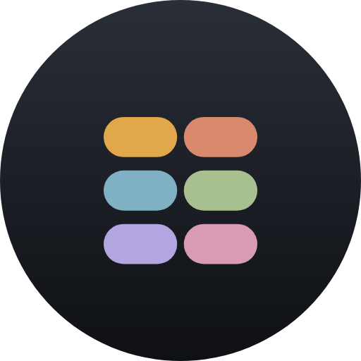

# Pastille



A home-screen widget with six pills. Each pill holds a phrase; one tap puts it on the clipboard, ready to paste anywhere.

- Out of the box it is a single glass line, four cells wide: four pills and a round edit button.
- Stretch it wider and more pills fit in the line, up to six. Stretch it taller and the six pills go into two rows of three, then three rows of two.
- Tap a pill: the phrase is copied and the pill floods with its colour for a moment. No window opens.
- Tap an empty pill: the editor opens on that slot.
- Each pill keeps its colour by position, so the hand learns where a phrase lives.
- The glass can be dimmed in four steps, 10 to 90 percent, separately for every widget.
- Every widget placed on the home screen has its own six phrases.
- Leaving the editor in any way saves what was typed.

No network, no background services, no permissions. Phrases are stored locally and are not backed up; this is not a password vault.

Android 8.0 or newer.

## Build

No Gradle, no IDE: `aapt2`, `javac`, `dx` (or `d8`), `zipalign` and `apksigner` on `PATH`, and the platform jar of API 34 or newer.

```sh
ANDROID_JAR=/path/to/android.jar \
KEYSTORE=/path/to/release.keystore KS_PASS=... KS_ALIAS=... \
./build.sh
```

The signed APK lands in `out/`. Making a release: `RELEASE.md`.

## Source

| File | Role |
| --- | --- |
| `PastilleWidget.java` | Widget rendering, the copy action and its flash |
| `PillStore.java` | Six phrases per widget, one preferences file each |
| `EditorActivity.java` | Configuration step and editor, one screen |
| `MainActivity.java` | Launcher screen: placed widgets, adding one |
| `Ui.java` | Palette and view builders |

## License

0BSD, see `LICENSE`.
